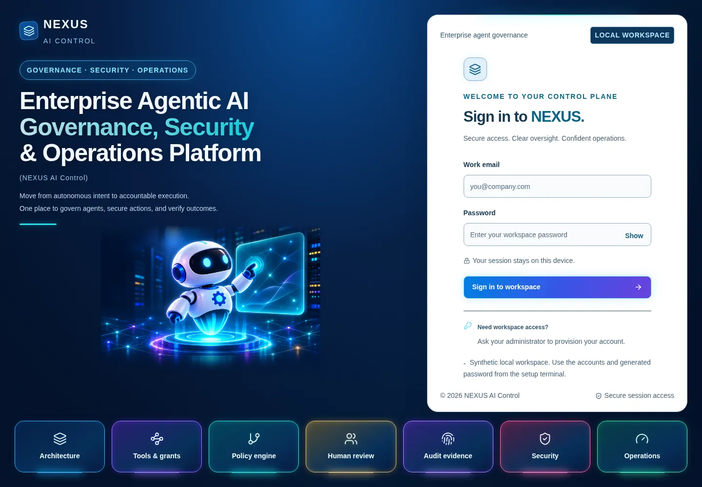
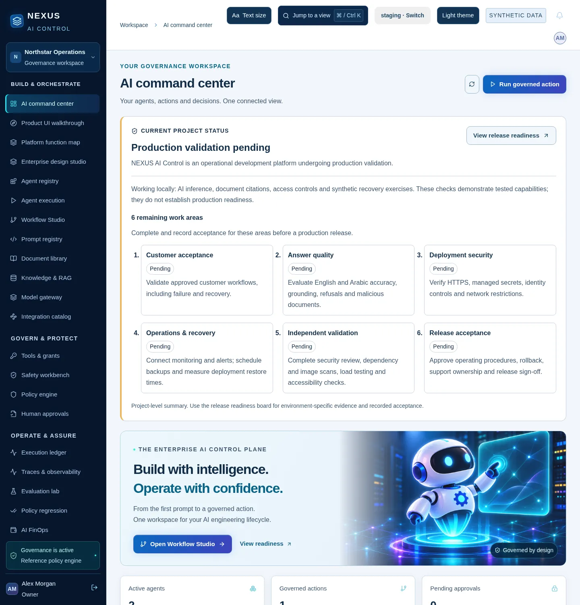
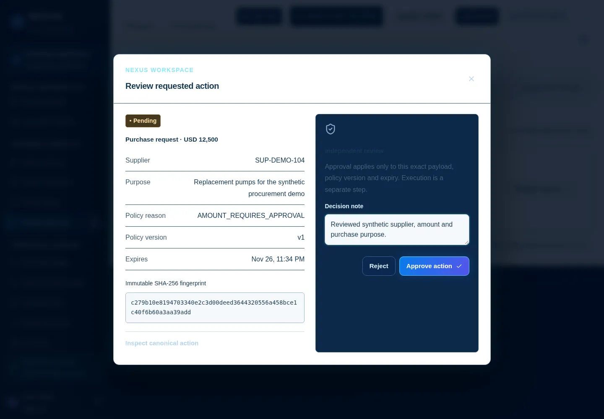
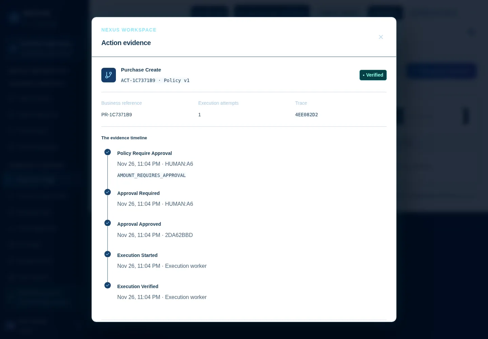

# NEXUS AI Control

NEXUS is a control plane for AI agents that request access to enterprise tools and data. It evaluates policy, routes sensitive actions to an independent reviewer, and records the outcome after a worker verifies the result.

**Release** 0.16.2 candidate · database schema 11 · local development and synthetic verification. Deployment acceptance is open.

[Running portal](#running-portal) · [Enterprise architecture](docs/ENTERPRISE_ARCHITECTURE.md) · [Engineering case study](docs/case-study/NEXUS_AI_CONTROL_CASE_STUDY.md) · [Run locally](#run-locally) · [Production roadmap](docs/PRODUCTION_ROADMAP.md)

## Running portal

Captured on 26 November 2026 from the authenticated React console, FastAPI API and execution worker at [the source revision under review](https://github.com/shah-hussain-bangash/nexus-ai-control/tree/c89707b7812c9d92ee3de93d2c2863921b1955bd). The run used a disposable local database, demo accounts and the synthetic connector.

### Workspace sign-in



The local workspace sign-in page is the entry point to the authenticated console.

### AI command center



The console shows the selected runtime environment and separates live governance records from deployment acceptance.

### Independent approval



Policy held the synthetic USD 12,500 request for independent review. A second account inspected the exact request and approved it. The decision is bound to the payload hash, policy version and expiry.

### Verified execution



The worker processed the approved request through the synthetic connector and the ledger showed the same request as **Verified**.

## What the platform implements

| Capability | Engineering detail |
| --- | --- |
| Governed tool execution | Explicit grants, typed tool input, reference or OPA policy decisions, revision-bound approval and dispatch revalidation |
| Durable execution and recovery | Queued actions, persisted workflow steps, bounded worker claims, idempotency and reconciliation of uncertain effects |
| Document AI and RAG | Reviewed intake, bounded extraction, English/Arabic search and authorization-filtered hybrid retrieval with versioned source evidence |
| Model gateway and cost controls | Opt-in routes, request and concurrency limits, cost reservations and usage accounting |
| Identity and operations | Scoped workspace/environment membership, audit events, readiness signals and encrypted backup exercises |

The [architecture guide](docs/ENTERPRISE_ARCHITECTURE.md) maps the request path to source code, tests and the evidence needed for a team pilot. The [case study](docs/case-study/NEXUS_AI_CONTROL_CASE_STUDY.md) explains design decisions and their trade-offs.

## Run locally

On Windows with Python and Node.js installed, follow the [Cursor quickstart](CURSOR_QUICKSTART.md) from the repository root.

```cmd
npm run setup
npm start
```

Use the loopback URL and the development password printed by the launcher setup. For an existing install, back up private configuration and the database before upgrading. Check the [schema upgrade notes](docs/PHASE_1_ENVIRONMENT_FOUNDATION.md) first.

## Verification and release scope

| Evidence | Observed result |
| --- | --- |
| Authenticated browser walkthrough | Submission required independent approval. The second account approved and the worker verified the result. No browser exceptions were observed. |
| Local frontend | 100 tests passed and the Vite production build succeeded. Vite reported an advisory for the main bundle exceeding 500 kB minified. |
| [GitHub Actions for the captured revision](https://github.com/shah-hussain-bangash/nexus-ai-control/actions/runs/45760501365) | Backend, PostgreSQL, Windows launcher, frontend and OPA jobs succeeded. |

The [local pilot runbook](docs/LOCAL_PILOT_ACCEPTANCE.md) has the repeatable checks and acceptance criteria. The [generated production roadmap](docs/PRODUCTION_ROADMAP.md) tracks 1 implemented workstream awaiting acceptance and 17 partial workstreams. The 18-area, 216-function catalog represents design previews. Customer workflow validation, independent bilingual answer evaluation, deployment security and measured recovery remain release gates.

<details>
<summary>Implementation guides and verification references</summary>

- [Implemented source and verification](docs/IMPLEMENTATION_REPORT.md)
- [All production gaps and ordered next work](docs/PRODUCTION_GAPS_0_16_0.md)
- [Every planned function and connected boundary](docs/FUNCTION_IMPLEMENTATION_MAP_0_16_0.csv)
- [Local hybrid retrieval](docs/HYBRID_RETRIEVAL_0_16_0.md)
- [Hybrid completion and concurrent source changes](docs/HYBRID_COMPLETION_ORDERING.md)
- [Local ranking response validation](docs/RANKING_RESPONSE_VALIDATION.md)
- [Disposable synthetic retrieval test](docs/SYNTHETIC_RETRIEVAL_DRILL.md) — `npm run test:retrieval`
- [Combined synthetic knowledge test](docs/SYNTHETIC_KNOWLEDGE_DRILL.md) — `npm run test:knowledge`
- [Synthetic file-ingestion test](docs/SYNTHETIC_INGESTION_DRILL.md) — `npm run test:ingestion`
- [File-worker completion deadlines](docs/INGESTION_COMPLETION_DEADLINES.md)
- [Extraction response validation](docs/EXTRACTION_RESPONSE_VALIDATION.md)
- [Members, roles and sessions](docs/IDENTITY_LIFECYCLE_0_16_0.md)
- [Paused agent-review expiry](docs/PAUSED_REVIEW_EXPIRY.md)
- [Durable worker claim deadlines](docs/DURABLE_CLAIM_DEADLINES.md)
- [Synthetic agent-workflow test](docs/SYNTHETIC_AGENT_DRILL.md) — `npm run test:agents`
- [Synthetic inference-control test](docs/SYNTHETIC_INFERENCE_DRILL.md) — `npm run test:inference`
- [Local Ollama connection](docs/LOCAL_OLLAMA.md) — opt-in local models without a provider API key
- [Document-backed model answers](docs/DOCUMENT_INFERENCE.md) — opt-in source excerpts with current access/version checks
- [Synthetic backup-safeguard test](docs/SYNTHETIC_BACKUP_DRILL.md) — `npm run test:backup`
- [Offline backup inspection](docs/OFFLINE_BACKUP_INSPECTION.md) — inspect backups without loading application settings
- [Streaming backup checksums](docs/BACKUP_STREAMING_CHECKSUMS.md) — verify payloads using bounded reads
- [Maintenance preview](docs/MAINTENANCE_PREVIEW.md) — preview cleanup without initializing or upgrading a database
- [Request rejection events](docs/REQUEST_REJECTION_EVENTS.md) — correlate oversized-request errors in structured logs
- [All synthetic drills in one command](docs/SYNTHETIC_SUITE.md) — `npm run test:synthetic`
- [Synthetic recovered-application test](docs/SYNTHETIC_RECOVERY_DRILL.md) — `npm run test:recovery`
- [Current UI baseline](docs/UI_BASELINE_0_16_0.json)
- [Historical machine-readable verification](docs/VERIFICATION.json)

</details>
