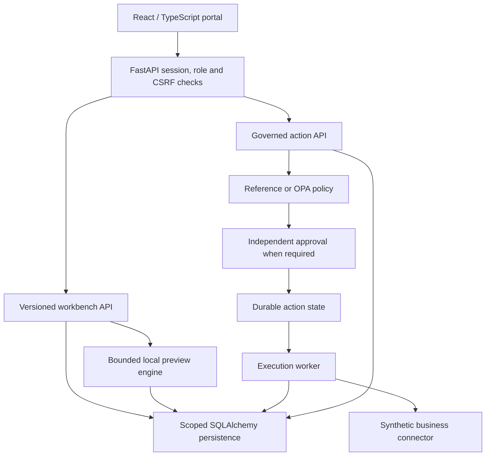

# NEXUS 0.4.0 architecture

The UI joins two deliberately distinct paths: local design previews and governed synthetic business execution. Both use the authenticated FastAPI control plane. A workbench run cannot authorize a purchase.

## Local preview engine

BM25 evidence retrieval, prompt composition, local guardrail rules, retrieval regression, cost planning and workflow traces run without external network access. WorkspaceAsset holds current configuration; AssetRevision stores revisions; WorkbenchRun records the exact saved version, results and measured local duration. Referenced assets are version-pinned and stale references fail closed. Audits preserve mutation/run references.

## Integration boundary

Model and connector contracts are persisted design records, not active adapters. They do not resolve secret references or contact configured endpoints. Release plans are not deployment executors. New provider execution, real customer connectors, distributed telemetry, enforced budgets and customer-cloud delivery are documented in IMPLEMENTATION_REPORT.md.

## Environment and tenancy

New workbench records use the existing organization scope and staging environment. This release does not introduce a multi-workspace switcher or full environment lifecycle. Tests verify cross-organization reads, mutations and references are denied. Existing runtime/IdP integration harnesses remain, but external-service tests were skipped during current local verification.
