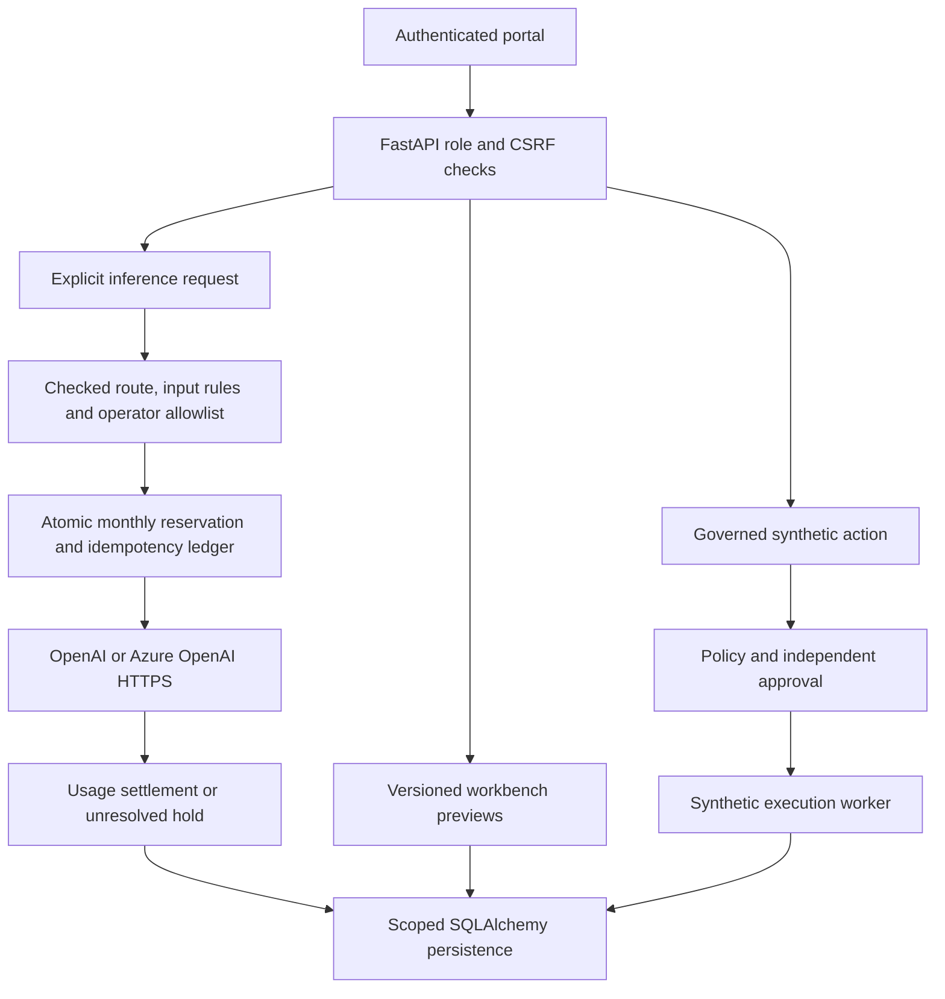

# NEXUS 0.5.0 runtime relationships

Provider requests are synchronous and non-streaming; they do not execute business tools. Workbench pipelines remain local dry runs. Durable multi-step agent execution and real customer adapters remain unimplemented. The deployment candidate adds an HTTPS edge and external IdP/PostgreSQL configuration, but is not proof of cloud readiness.
