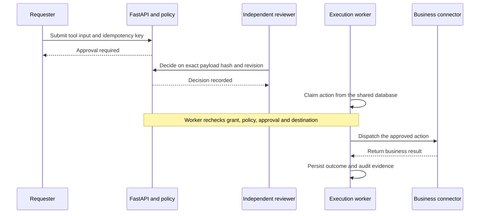

# NEXUS AI Control enterprise architecture

**Baseline** [0.16.2 candidate, schema 11](https://github.com/shah-hussain-bangash/nexus-ai-control/tree/c89707b7812c9d92ee3de93d2c2863921b1955bd). See the [case study](case-study/NEXUS_AI_CONTROL_CASE_STUDY.md) for the design rationale and the [generated roadmap](PRODUCTION_ROADMAP.md) for workstream status.

## Runtime and trust boundaries

| Boundary | Current implementation | Deployment dependency |
| --- | --- | --- |
| Browser → API | [React/TypeScript console](../frontend/src/main.tsx) and [FastAPI](../backend/nexus/app.py). The server checks the authenticated actor, organization, current environment and permissions. | HTTPS, approved ingress and identity lifecycle fit the target environment. Local sign-in is for development. |
| Request → policy | [Action service](../backend/nexus/service.py) validates the tool contract, arguments, grants and policy before accepting work. The [policy adapter](../backend/nexus/policy.py) supports reference evaluation or OPA. | Policy ownership, change review and integration tests for the selected action. |
| API → durable state → worker | [SQLAlchemy models](../backend/nexus/db.py) persist actions, approvals and audit events. The [worker](../backend/nexus/worker.py) claims action rows and rechecks authority before dispatch. | Managed PostgreSQL, capacity planning, monitored worker health and proven backup/restore. |
| Worker → business system | A [synthetic connector](../backend/nexus/mock_connector.py) uses a separate SQLite store locally. The [HTTP adapter](../backend/nexus/business_connector.py) uses an operator-configured destination and checks returned evidence against the request. | Approved sandbox, reviewed [business contract](../contracts/nexus-business-v1.openapi.json), credential custody and enforced network egress. |
| Documents → retrieval | [Intake](../backend/nexus/ingestion.py), bounded extraction, reviewed publication and [local hybrid retrieval](../backend/nexus/hybrid.py) keep source access and latest versions relevant to retrieval. | Approved storage and retention, independent English/Arabic evaluation and parser isolation in the deployment environment. |
| Inference → model route | [Inference controls](../backend/nexus/inference.py) apply input checks, admission limits and cost accounting for configured routes. | Explicit provider and data approval, verified quotas, spending limits and service failure handling. |

The repository's [Compose example](../compose.yaml) runs separate API and worker services with PostgreSQL and OPA for synthetic development. The [pilot infrastructure reference](../infra/README.md) documents stronger deployment controls. The default local launcher uses SQLite, the reference policy engine, a synthetic business connector and disabled live inference.

## Governed purchase reference flow

If policy denies the request, it never reaches dispatch. If the external effect is ambiguous, the [control plane](../backend/nexus/app.py) preserves the uncertainty for reconciliation. An idempotency key protects repeats of the same intent. End-to-end duplicate prevention also depends on the destination respecting its contract.

## Software engineering evidence

| Control | Review entry point | What the evidence covers |
| --- | --- | --- |
| Independent review and time-of-dispatch checks | [Control plane tests](../backend/tests/test_control_plane.py) | Requester separation, stale or modified payload rejection, grant revocation, expiry, idempotency and ambiguous-result reconciliation |
| Durable workflow state | [Durable workflow tests](../backend/tests/test_durable.py) and [claim deadlines](DURABLE_CLAIM_DEADLINES.md) | Persisted progress, review gates and conservative claim recovery |
| Trust in current document access | [Hybrid completion ordering](HYBRID_COMPLETION_ORDERING.md) and [document environment tests](../backend/tests/test_document_environment_context.py) | Source access changes, version checks and scoped document operations |
| Deployable code and regression checks | [GitHub Actions](../.github/workflows/ci.yml) and [integration guide](INTEGRATION_TESTS.md) | Backend, Windows launcher, frontend, OPA and PostgreSQL jobs with different dependencies and coverage |
| Backup and recovery | [SQLite recovery procedure](ISOLATED_SQLITE_RECOVERY.md) and [PostgreSQL CI rehearsal](CI_POSTGRESQL_RECOVERY.md) | Scoped recovery exercises. Deployment restore time and data-loss tolerances must be measured on the target topology. |

## Acceptance for a bounded team pilot

Start with one approved, reversible workflow in a dedicated sandbox. Assign the responsibilities below and agree the thresholds before collecting evidence. Use the [local pilot procedure](LOCAL_PILOT_ACCEPTANCE.md) for the existing single-operator setup.

| Gate | Suggested accountable team | Evidence required to close |
| --- | --- | --- |
| 1. Identity, secrets and network | Platform and security | Verified MFA and offboarding, cross-environment access tests, credential rotation, enforceable egress and TLS evidence |
| 2. Business execution and reconciliation | Workflow owner and engineering | Positive and negative authorization cases, replay testing against the sandbox, and proof that a lost response can be reconciled without a duplicate effect |
| 3. Bilingual grounding and document controls | AI evaluation and data governance | Reviewed English/Arabic corpus, agreed scoring thresholds, cited-answer and abstention tests, access revocation and deletion verification |
| 4. Reliability and recovery | Operations | Measured SLOs, alert delivery, representative load and failure tests, and an isolated restore drill against agreed RPO/RTO |
| 5. Release decision | Release owner and independent reviewers | Recorded security and accessibility review, rollback rehearsal, open findings and an explicit decision for the intended users and data |

The pilot and production acceptance artifacts belong with the intended environment and source revision. See [production acceptance](PRODUCTION_ACCEPTANCE.md) for the broader criteria.
