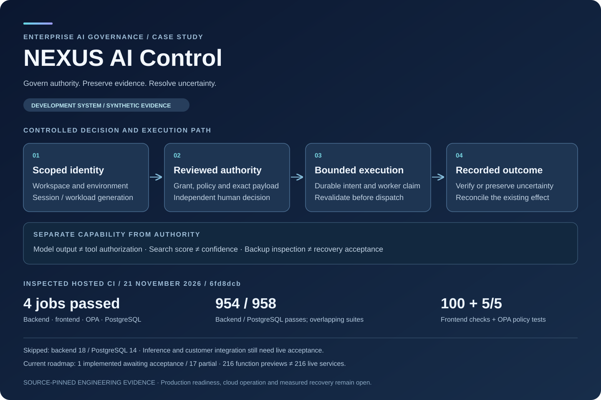
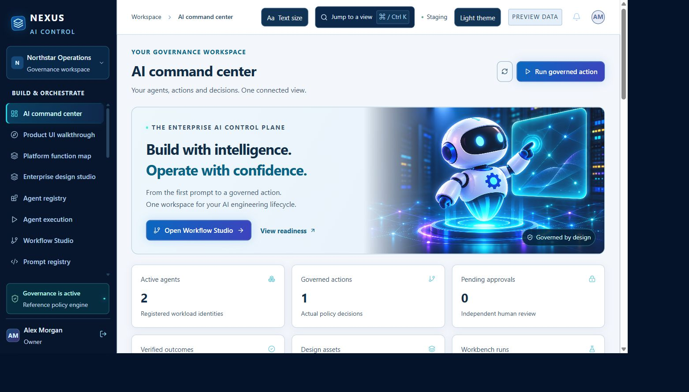
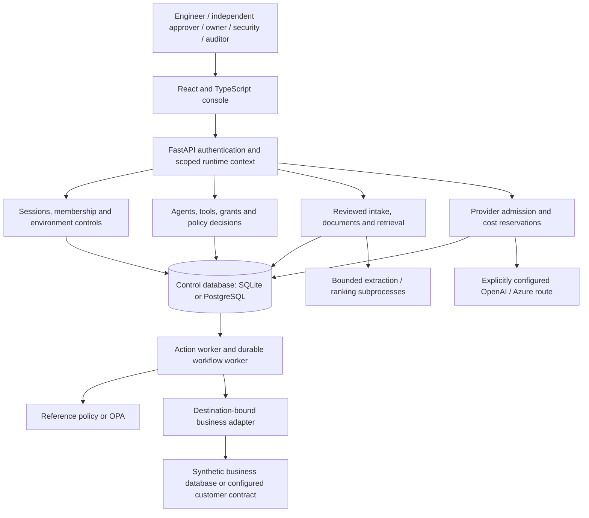
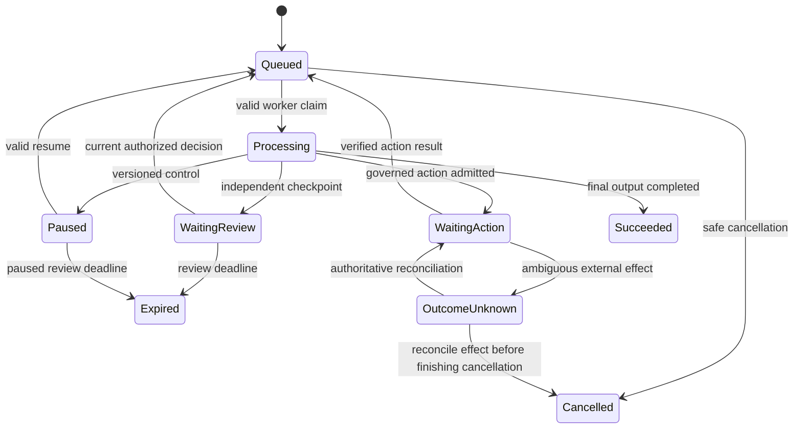

# NEXUS AI Control Case Study

## Architecting governed AI execution, evidence retrieval and operational accountability

**Enterprise solution architecture · Agentic workflow controls · Generative AI integration · Security and governance · AI FinOps · Retrieval engineering · Infrastructure design · Software engineering · Applied research**

| Project | At a glance |
|---|---|
| Project owner | Shah Hussain Bangash · [GitHub](https://github.com/zenithdevelopers7-source) |
| Domain | Enterprise AI governance, security and operations |
| Source baseline | [`6fd8dcb`, reviewed 21 November 2026][baseline] |
| Current source | 0.16.2 candidate; database schema 11 |
| Application | React / TypeScript, FastAPI / Python, SQLAlchemy; SQLite local mode and PostgreSQL integration |
| Execution | Persisted action outbox, bounded durable runs, independent approval and explicit reconciliation |
| Retrieval | ACL-first local LSA/BM25 ranking with current source citations |
| Inference | Explicit provider enablement, reviewed routes, integer cost reservations and owner reconciliation |
| Hosted evidence | [Run 44884584540][ci]: all four jobs successful; backend 954 passed / 18 skipped; PostgreSQL job 958 passed / 14 skipped; frontend 100 passed; OPA 5/5 |
| Release boundary | Development platform; current roadmap records 1 implemented workstream awaiting acceptance and 17 partial workstreams |

**The architectural contribution:** NEXUS makes authority, evidence and uncertainty explicit around AI-assisted work. A model response does not authorize a business action. An approval binds a particular request and destination. A timeout does not establish that nothing happened. A retrieved passage remains usable only while its source revision and permissions remain valid.

[Business problem](#1-business-problem-and-objectives) · [Architecture](#3-solution-architecture) · [Governed execution](#4-governed-actions-and-durable-workflows) · [Inference controls](#5-generative-ai-inference-and-cost-governance) · [Knowledge](#6-document-intake-retrieval-and-bilingual-evaluation) · [Evidence](#10-engineering-evidence-and-reproducibility) · [Demonstration](#12-technical-demonstration-and-next-delivery-gates)

### Application design preview

*Captured on 21 November 2026 from the available local synthetic UI harness. Its retained snapshot and footer identify the earlier 0.16.0 interface baseline. PREVIEW DATA is visible; counts, identities and recorded examples are synthetic. This image illustrates the design, while the source and hosted tests cited below establish current engineering evidence. The harness blocks runtime mutations and does not demonstrate authenticated execution, live providers or a production deployment.*

## 1. Business problem and objectives

Enterprise AI introduces a coordination problem beyond generating useful text. A team needs to know which workload may use which tool, what policy applies, who approved an action, whether its inputs changed, what a remote system actually accepted and how much unresolved inference may still cost.

These questions become harder when sessions change environments, reviewers leave a workflow paused, workers restart, documents lose access permissions or a provider returns an ambiguous response. A visually complete control dashboard does not resolve those problems by itself.

NEXUS addresses them with versioned control records, scoped runtime operations, independently reviewed decisions and persistent outcome states.

| Business objective | Architectural response | Measure for a future pilot |
|---|---|---|
| Preserve accountable business authority | Tool grants, policy checks, exact-payload approval and dispatch revalidation | Unauthorized/stale action rejection and approval turnaround |
| Avoid repeated effects after uncertainty | Immutable intent, persistent actions, unknown outcomes and authoritative reconciliation | Duplicate effects and unresolved-operation age |
| Bound inference exposure | Reviewed provider route, shared admission limits and held/spent ledger | Admission rejection, unresolved cost and provider-invoice variance |
| Keep evidence permission-aware | ACL-first retrieval, revision/hash checks and history revalidation | Access-change leakage and citation-validity rate |
| Make delivery status reviewable | Source-backed workstreams and explicit acceptance gaps | Accepted release gates with named owners and dated evidence |

These are proposed business measures. Cost savings, increased productivity, incident reduction and enterprise adoption have not been established by the synthetic demonstrations.

## 2. A connected enterprise scenario

An engineer prepares a bounded workflow to inspect a supplier and submit a purchasing request. The workload has a registered identity and an explicit grant to the selected tool. Policy may permit the lookup while requiring separate approval for a purchase.

1. The engineer submits an immutable workflow definition under a scoped request key.
2. A worker advances checkpoints and creates governed action intents.
3. A supplier result must match the expected operation and scope.
4. An independent reviewer decides the workflow checkpoint; purchase authority still requires its own policy-bound action approval.
5. The execution worker rechecks access, workload generation, grant, policy, destination and payload before dispatch.
6. A timeout after remote acceptance leaves the effect uncertain.
7. The operator reconciles the existing operation instead of creating a replacement purchase.
8. The ledger retains the cancellation, reconciliation or verified result.

The [synthetic agent drill][agent-drill] exercises this distinction using one lookup effect and one purchase effect across cancellation, expiry and recovery scenarios. It demonstrates a controlled fixture, not customer-side purchasing acceptance.

## 3. Solution architecture

This is a logical deployment view. The default application selects local reference policy, a synthetic business connector and disabled live inference. PostgreSQL, OPA, OIDC and provider adapters introduce additional configuration and acceptance requirements. The [source configuration][config] validates those choices rather than inferring them from UI design records.

The control database persists authority, workflow and accounting state. The default synthetic business system uses a separate SQLite database, making the separation between local command intent and an accepted business effect inspectable. An external adapter must implement the configured contract; the repository does not establish compatibility with arbitrary ERP or CRM APIs.

The 18-area / 216-function interface catalog describes intended product scope. It must not be counted as 216 completed backend integrations. The [current roadmap][roadmap] is the more useful release boundary.

## 4. Governed actions and durable workflows

### Approval binds an executable request

The [action service][service] checks workload status, tool version, expected action/resource, validated arguments and an explicit grant. Policy selects allow, deny or require approval. Allowed work becomes a persistent action row; approval-required work remains pending.

The immutable envelope includes organization, environment, workload, tool/version, arguments, policy version, simulation mode and connector destination. Its canonical JSON fingerprint binds the reviewed meaning. A changed request cannot reuse the same intent key.

A purchase approval expires after 30 minutes. The requesting author cannot decide it. The decision carries an expected revision and request hash; stale decisions, changed policy or altered payloads are rejected.

The [execution worker][worker] repeats the important checks at dispatch: current access, active workload generation, grant, policy, approval validity, destination and envelope hash. This addresses the interval between submission and execution. Its documented dispatch cutoff also matters: revocation after the external call is admitted cannot undo an effect already sent.

### Durable execution preserves uncertainty

The [durable runtime][durable] accepts 2–12 explicitly defined steps: checkpoint, independent approval, governed action and output. It persists cursor, step outcomes, versions, leases and cancellation state. This is bounded deterministic orchestration, not autonomous model planning or a general parallel agent scheduler.

A worker claim has a 30-second deadline. A matching token alone is insufficient after that deadline. Expired claims recover conservatively, with bounded recovery attempts. Review expiry is checked even for a paused run.

This diagram summarizes important transitions rather than every internal state. Cancellation records intent to stop; it does not pretend to reverse an uncertain remote purchase. Polling and recovery return current records without repeating the external operation.

### Connector identity is part of authority

The [business adapter][connector] accepts an operator-configured HTTPS host, safe base path, remote tenant and named server credential. Request data cannot supply an arbitrary destination. Responses are bounded and must bind the operation, organization, tenant and expected result fields.

Redirects are not followed, automatic HTTP retries are disabled and ambiguous failures require reconciliation. These are application controls. DNS, private networking, managed credentials and deployment-enforced egress restrictions remain separate responsibilities.

## 5. Generative AI inference and cost governance

NEXUS implements an explicitly enabled inference path, separate from business-tool dispatch. The [inference service][inference] validates model revision, approved route, host allowlist, pricing and available budget. Missing price or authority prevents provider work.

Blocking guardrails inspect original query and reference text before redaction can hide a blocking signal. Transformed content is also checked. This ordering is useful defense in depth; it does not establish complete prompt-injection resistance or generated-answer correctness.

Admission rechecks authorization after preparation, then commits a reservation before contacting the provider. Rates and costs use integer micro-USD:

`charged micro-USD = ceil(input tokens × configured input rate + output tokens × configured output rate)`

The configured rates are USD per million tokens, so that multiplication yields micro-USD. Rates are operator inputs, not independently verified market prices. Provider fees, tax and invoice reconciliation remain outside this calculation.

The [accounting module][accounting] deliberately shares monthly budgets and admission limits across a workspace. Selecting another environment does not create a fresh allowance. Call history remains environment-scoped.

| Outcome | Accounting and recovery behavior |
|---|---|
| Successful validated provider response | Settle reservation using recorded usage |
| Timeout, malformed response, redirect or ambiguous failure | Preserve unknown outcome and held reservation |
| Identical completed/unknown replay | Recover existing record without another provider request |
| Changed request under an existing key | Reject conflicting immutable intent |
| Owner supplies authoritative usage | Settle unresolved usage once; retain reconciliation record |

Response-size and elapsed-time checks bound acceptance. A response reaching the exact deadline remains uncertain, since usage may already have occurred. Owner reconciliation records usage; it does not fabricate a missing answer.

The [inference drill][inference-drill] defines 27 checks with seven mock requests and a 40 micro-USD fixture ledger. Those amounts are synthetic accounting assertions, not a real provider bill.

## 6. Document intake, retrieval and bilingual evaluation

### Review before source publication

The [intake workflow][intake] stores immutable files in a persistent queue, extracts them in a bounded subprocess and requires an authorized review before publication. That publication review is an operator attestation, not the independent action-approval policy.

Bounds include 1 MiB original files, 12 PDF pages, 32 KiB extracted text, constrained DOCX members and a configurable parser deadline. OCR is off by default. Real English OCR was recorded in earlier Linux verification; Arabic OCR quality and native Windows acceptance remain open.

Published citations identify text chunks, not original page coordinates. Original upload bytes are cleared through the intake lifecycle; the application is not a permanent original-document archive. Enterprise records retention needs a separate approved design.

### Fit the ranking corpus only after authorization

[Local hybrid retrieval][hybrid-doc] combines BM25 with corpus-fitted latent semantic analysis using TF-IDF, normalized vectors and truncated SVD. It is an implemented local ranking algorithm, not a neural embedding service, vector database or learned reranker.

Authorization precedes corpus fitting. A private document should neither appear as a hit nor influence another reader's ranking model. Source scope, revision and content are checked again after computation; saved history rechecks current access and citation hashes before exposing excerpts.

The bounded search supports up to 20 selected documents, 128 chunks, 1,024 vocabulary terms, top-k 1–10 and an eight-second worker deadline. Capacity errors are explicit. Receipts retain hashes, source references and scores, while avoiding stored query text and excerpts. Source text still exists in the document subsystem, so this is not a claim of zero data retention.

[Arabic normalization][arabic] broadens matching for vowel marks, tatweel, presentation forms and selected letter variants while preserving original excerpts and citation hashes. It does not provide translation, morphological understanding or bilingual relevance acceptance.

### Evaluate retrieval separately from answers

The [retrieval drill][retrieval-drill] contains an especially useful failure example. Adding an authorized but unlabelled matching source can preserve recall at 100% while reducing precision from 100% to 50%. The saved comparison reports that regression rather than presenting recall alone as quality.

English, Arabic, bilingual and unlabelled groups are explicit reviewer labels. Historical scores remain historical when sources or tokenization change. Generated-answer grounding, refusal, poisoning resistance and representative bilingual evaluation are further work.

## 7. Identity, environment isolation and concurrency

The [security implementation][security] separates human sessions and workload tokens. Browser session tokens are hashed in persistence; writes require CSRF. Roles distinguish operation, independent approval, policy administration, membership and export authority.

Workload tokens carry organization, environment, generation and a five-minute expiry. Suspending a workload or changing its generation can invalidate subsequent admission. This is an application-managed token mechanism; workload federation and managed identity acceptance remain open.

[Member administration][membership] supports reviewed provisioning, exact configured OIDC issuer/subject binding, non-owner role changes, deactivation and session revocation. It does not create external IdP users, deliver invitations, provide SCIM/SAML or establish verified MFA.

[Local environment selection][environments] uses authenticated session binding and expected revisions. Headers assert the selected context rather than granting permission to choose a namespace. Switching rotates CSRF and invalidates old context; background jobs retain their persisted origin.

This matters when a user changes environments while a response is in flight. The result must not be delivered into the new context merely because the browser still has a valid session. Human writes, selection and final inference admission use a shared workspace ordering with fresh authorization checks.

New local environments start with purchasing disabled. Pause and retirement require reviewed versions and no unresolved operational obligations. A namespace called production is still a local namespace. Pilot lifecycle and general configuration promotion are incomplete.

These controls demonstrate application-level scoping and targeted concurrency handling. They do not establish database row-level security, independent tenant penetration testing or load acceptance.

## 8. Security, audit and recovery design

| Risk | Implemented control | Remaining acceptance |
|---|---|---|
| Unauthorized or changed tool execution | Grants, policy, generation, payload/destination binding and dispatch revalidation | Real customer contract and deployed access review |
| Stale browser/environment context | Session revisions, current membership checks and response fencing | Multi-instance security and lifecycle assessment |
| Malicious document content | Bounded parser process, resource/output checks and publication review | Malware scanning and complete OS/network sandbox |
| Changed supplier evidence export | Strict format validation and SHA-256 integrity check | Authenticated signatures and immutable off-host archive |
| Lost or altered backup | Quiesced snapshots, checksums, SQLite integrity and AES-256-GCM archive inspection | Full application/PostgreSQL restore, key custody and measured RPO/RTO |

[Supplier-check evidence][supplier-evidence] is deliberately unsigned. A checksum detects a changed file only relative to a trusted expected value; an editor can recompute an unsigned checksum. The offline verifier does not authenticate the author or grant customer acceptance.

The [encrypted backup implementation][backup] requires explicit acknowledgement that writers are quiesced. It uses a separately supplied 32-byte key, a fresh nonce and authenticated encryption. Authentication completes before archive members are extracted; member names, count, size and manifest consistency are checked.

The [backup drill][backup-drill] defines 27 checks covering wrong keys, ciphertext tampering, truncation, malformed authenticated archives, unsafe member paths, source preservation and cleanup. It does not restore active data. Successful inspection is not disaster recovery, secure erasure or proof of a recovery-time objective.

## 9. Architecture decisions and trade-offs

| Decision | Why it helps | Cost or limitation |
|---|---|---|
| Persistent action rows as the outbox | Authority and queued work commit together | Retention, throughput and operator recovery need deployment design |
| Revalidate immediately before dispatch | Stops stale approvals and revoked access before the cutoff | Cannot reverse an effect already admitted remotely |
| Preserve unknown outcomes | Avoids false failure and blind duplicate requests | Operators need authoritative reconciliation evidence |
| Separate inference from business tools | A text response cannot silently become purchase authority | Connected workflows require explicit reviewed handoffs |
| Workspace-wide inference budgets | Environment switching cannot reset cost exposure | Fair allocation and chargeback need additional policy |
| ACL-first local LSA/BM25 | Inspectable ranking without sending sources to a provider | Bounded corpus, no persistent neural index or proven relevance |
| Explicit design/implementation/acceptance states | Makes a large product scope reviewable | Source completion still needs environment-specific acceptance |

The research value lies in making these boundaries testable: guardrail ordering, permission influence on ranking, exact-deadline behavior, stale claim rejection and uncertain-effect cancellation. These are engineering experiments on controlled fixtures; no new algorithm, peer-reviewed result or production benchmark is claimed.

## 10. Engineering evidence and reproducibility

The inspected [hosted run][ci] targets the pinned source and completed all four jobs.

| Job | Observed result | Interpretation |
|---|---|---|
| Backend | 954 passed, 18 skipped; roadmap consistency check passed | Broad regression evidence for the configured CI environment |
| PostgreSQL | 958 passed, 14 skipped against PostgreSQL 16 | Overlapping suite with enabled database integration; do not add this count to the backend total |
| Frontend | 100 tests passed; production build passed | Node-based checks and build evidence, not 100 browser journeys |
| OPA | 5/5 policy tests passed | Rego policy tests, not deployed OPA availability or a live customer policy assessment |

A frontend bundle-size advisory remains. Skipped tests remain visible; a successful job does not make skipped external-service coverage pass. Historical `docs/VERIFICATION.json` describes 0.16.0/schema 8 and is not substituted for current schema-11 evidence.

This case-study review inspected source, documentation and hosted logs. Normalized content hashes matched 61 relevant local Python files against the pinned Git tree. The local disposable drill command could not start because its virtual environment referenced an inaccessible interpreter; those drills were not independently rerun here. The screenshot came from the isolated UI harness, not a successful local authenticated-backend rehearsal.

The repository provides separate commands for disposable retrieval, connector, ingestion, agent, inference and backup exercises. Their reports are unsigned local evidence. Use the project quickstart, run the selected command, inspect its actual report and preserve the source/environment context before citing a result.

[Case-study evidence review](evidence/nexus-evidence-review-2026-11-21.json) records the inspected run, counts, source baseline, screenshot boundary and local verification limitation.

## 11. Infrastructure and enterprise delivery

The [container and composition assets][compose] separate API, execution worker, PostgreSQL and OPA. The Docker image uses a non-root application user. These are reference delivery assets, not evidence of an accepted cloud deployment.

Pilot configuration requires PostgreSQL with certificate verification, HTTPS application/IdP origins, OPA and an explicit required MFA authentication context. Configuration validation can require those values; only real IdP and deployment testing can establish their behavior.

A scoped enterprise delivery plan should add managed secrets and key rotation, private connectivity and enforced egress, approved original-document storage, source ACL synchronization, off-host telemetry, immutable audit retention, scheduled backups and tested recovery. Target services and region should follow the employer's existing platform, residency requirements and operating ownership.

The [current roadmap][roadmap] records one implemented workstream awaiting acceptance and 17 partial workstreams. Those states are not a production-completion percentage. The platform's architectural breadth becomes credible when each selected release gate has an owner, evidence and explicit scope.

## 12. Technical demonstration and next delivery gates

A focused interview demonstration can follow one controlled decision:

1. Explain the boundary between the 216 design previews and connected runtime services.
2. Show a registered workload, its tool grant and the current policy.
3. Submit a bounded workflow and inspect its immutable intent.
4. Demonstrate independent checkpoint review and separate purchase approval.
5. Change a relevant version or payload and show rejection before execution.
6. Introduce a synthetic uncertain outcome; recover the same record and reconcile without repeating the effect.
7. Show that environment switching preserves job provenance and workspace budget exposure.
8. Compare a retrieval regression with unchanged recall but reduced precision.
9. Inspect an unsigned evidence export and explain what its checksum proves.
10. Close with the selected production acceptance gaps and the hosted source evidence.

| Next gate | Required evidence |
|---|---|
| One customer sandbox | Destination-bound contract, idempotency, tenant scope and uncertain-result reconciliation |
| Scoped knowledge release | Representative bilingual relevance, access/deletion propagation and chosen answer-quality tests |
| Provider acceptance | Actual model/route errors, usage reconciliation, budget behavior and approved content handling |
| Operational readiness | Managed secrets, network policy, external telemetry, alerts and authenticated retention |
| Deployment acceptance | Independent security/load/accessibility review, full restore, rollback and measured recovery objectives |

NEXUS supports a senior architecture discussion because its most useful decisions connect AI capability to identity, authority, cost and recoverability. The case study's evidence supports that engineering discussion while keeping customer deployment and production acceptance as explicit next gates.

[baseline]: https://github.com/zenithdevelopers7-source/nexus-ai-control/commit/6fd8dcb6e84ce181db5b587426555facf9d34cd6
[ci]: https://github.com/zenithdevelopers7-source/nexus-ai-control/actions/runs/44884584540
[roadmap]: https://github.com/zenithdevelopers7-source/nexus-ai-control/blob/6fd8dcb6e84ce181db5b587426555facf9d34cd6/docs/PRODUCTION_ROADMAP.md
[config]: https://github.com/zenithdevelopers7-source/nexus-ai-control/blob/6fd8dcb6e84ce181db5b587426555facf9d34cd6/backend/nexus/config.py
[service]: https://github.com/zenithdevelopers7-source/nexus-ai-control/blob/6fd8dcb6e84ce181db5b587426555facf9d34cd6/backend/nexus/service.py
[worker]: https://github.com/zenithdevelopers7-source/nexus-ai-control/blob/6fd8dcb6e84ce181db5b587426555facf9d34cd6/backend/nexus/worker.py
[durable]: https://github.com/zenithdevelopers7-source/nexus-ai-control/blob/6fd8dcb6e84ce181db5b587426555facf9d34cd6/backend/nexus/durable.py
[connector]: https://github.com/zenithdevelopers7-source/nexus-ai-control/blob/6fd8dcb6e84ce181db5b587426555facf9d34cd6/backend/nexus/business_connector.py
[inference]: https://github.com/zenithdevelopers7-source/nexus-ai-control/blob/6fd8dcb6e84ce181db5b587426555facf9d34cd6/backend/nexus/inference.py
[accounting]: https://github.com/zenithdevelopers7-source/nexus-ai-control/blob/6fd8dcb6e84ce181db5b587426555facf9d34cd6/backend/nexus/inference_accounting.py
[intake]: https://github.com/zenithdevelopers7-source/nexus-ai-control/blob/6fd8dcb6e84ce181db5b587426555facf9d34cd6/docs/DOCUMENT_INTAKE_0_13_0.md
[hybrid-doc]: https://github.com/zenithdevelopers7-source/nexus-ai-control/blob/6fd8dcb6e84ce181db5b587426555facf9d34cd6/docs/HYBRID_RETRIEVAL_0_16_0.md
[arabic]: https://github.com/zenithdevelopers7-source/nexus-ai-control/blob/6fd8dcb6e84ce181db5b587426555facf9d34cd6/docs/ARABIC_SEARCH.md
[security]: https://github.com/zenithdevelopers7-source/nexus-ai-control/blob/6fd8dcb6e84ce181db5b587426555facf9d34cd6/backend/nexus/security.py
[membership]: https://github.com/zenithdevelopers7-source/nexus-ai-control/blob/6fd8dcb6e84ce181db5b587426555facf9d34cd6/docs/IDENTITY_LIFECYCLE_0_16_0.md
[environments]: https://github.com/zenithdevelopers7-source/nexus-ai-control/blob/6fd8dcb6e84ce181db5b587426555facf9d34cd6/docs/LOCAL_ENVIRONMENT_SWITCHING.md
[supplier-evidence]: https://github.com/zenithdevelopers7-source/nexus-ai-control/blob/6fd8dcb6e84ce181db5b587426555facf9d34cd6/docs/GOVERNED_SUPPLIER_CHECKS.md
[backup]: https://github.com/zenithdevelopers7-source/nexus-ai-control/blob/6fd8dcb6e84ce181db5b587426555facf9d34cd6/backend/nexus/encrypted_backup.py
[agent-drill]: https://github.com/zenithdevelopers7-source/nexus-ai-control/blob/6fd8dcb6e84ce181db5b587426555facf9d34cd6/docs/SYNTHETIC_AGENT_DRILL.md
[inference-drill]: https://github.com/zenithdevelopers7-source/nexus-ai-control/blob/6fd8dcb6e84ce181db5b587426555facf9d34cd6/docs/SYNTHETIC_INFERENCE_DRILL.md
[backup-drill]: https://github.com/zenithdevelopers7-source/nexus-ai-control/blob/6fd8dcb6e84ce181db5b587426555facf9d34cd6/docs/SYNTHETIC_BACKUP_DRILL.md
[retrieval-drill]: https://github.com/zenithdevelopers7-source/nexus-ai-control/blob/6fd8dcb6e84ce181db5b587426555facf9d34cd6/docs/SYNTHETIC_RETRIEVAL_DRILL.md
[compose]: https://github.com/zenithdevelopers7-source/nexus-ai-control/blob/6fd8dcb6e84ce181db5b587426555facf9d34cd6/compose.yaml
